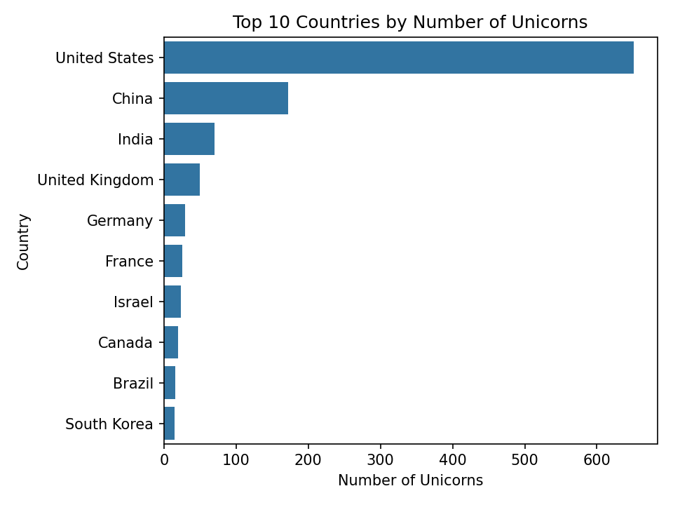
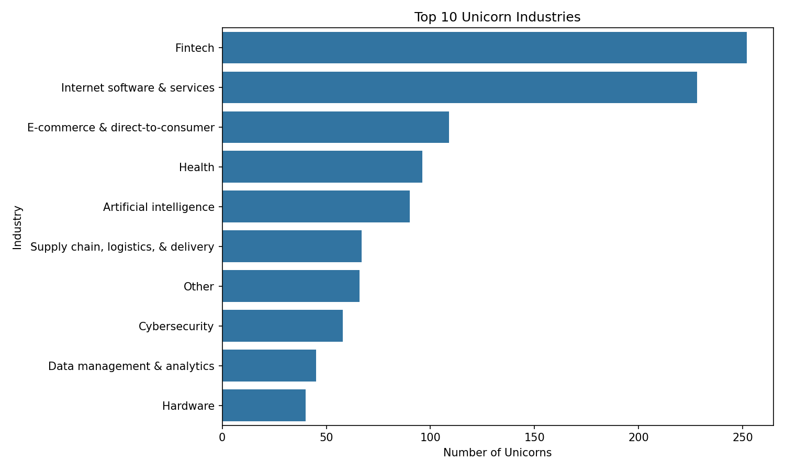
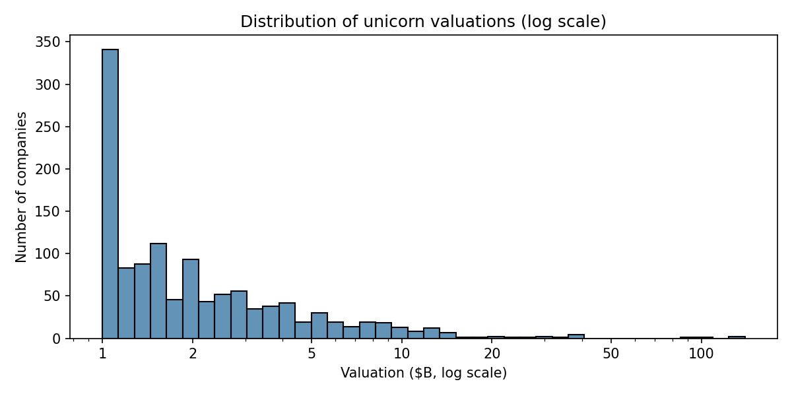
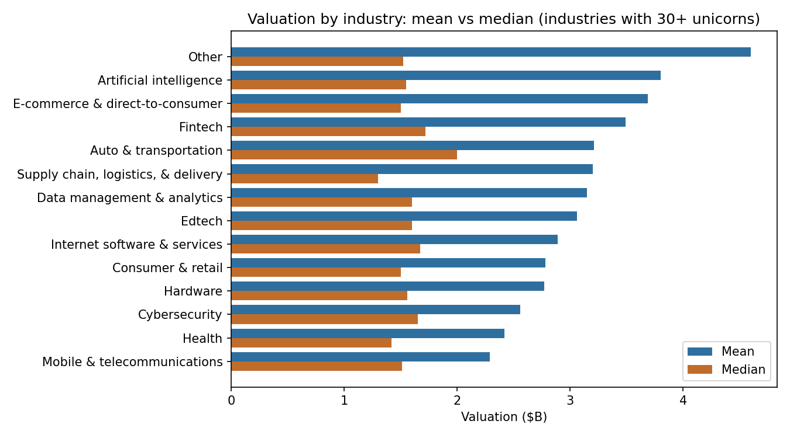
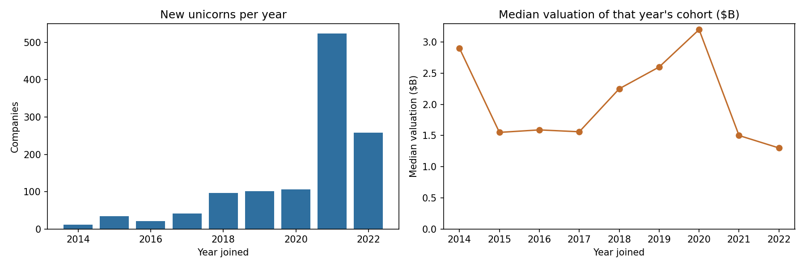
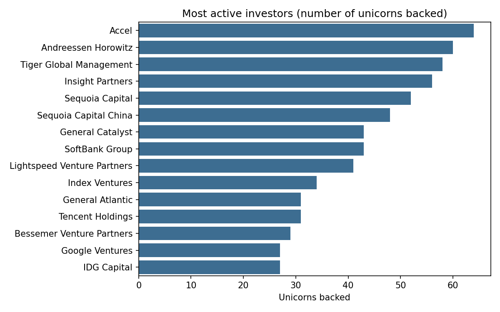

# Global Unicorn Companies: Where They Are, What They Do, What They're Worth

A Python analysis of 1,205 unicorn companies (privately held start-ups valued at $1 billion or more): cleaning the data, engineering features, answering four research questions, and then testing my own conclusions against the data.

| | |
|---|---|
| **Scope** | Data cleaning, feature engineering, statistical analysis, visualisation, written report, and a verification pass on the conclusions |
| **Context** | ESCP Business School, *Key Scientific and Technological Issues in Business*, spring 2025. Submitted as a group assignment with no formal division of tasks; I wrote the Python analysis and most of the report. |
| **Data** | 1,205 unicorn companies, 2007 to 2022 join dates, 7 raw fields |
| **Tools** | Python (pandas, matplotlib, seaborn), Jupyter |

## Headline results

- **Three countries hold 74% of all unicorns:** the US (651, 54.0%), China (172, 14.3%) and India (70, 5.8%).
- **Valuations are extremely skewed:** mean $3.21B against a median of $1.60B, skewness **12.48**. 87% of unicorns are valued below $5B; the ten largest hold 17.7% of total value.
- **Unicorn creation exploded after 2017:** 93.6% of companies joined in 2017 or later, and 43.5% (524) in 2021 alone.
- **Industry barely predicts a typical valuation.** AI and e-commerce have the highest *average* valuations, but that is driven by a few giants; medians sit between $1.3B and $2.0B in every sector.
- **Typical valuations are similar across regions** ($1.50B to $1.65B), even though unicorn counts differ enormously.

## Research questions

1. Which countries and industries produce the most unicorns?
2. How have unicorn valuations and frequency evolved over time?
3. What patterns exist in valuation distribution?
4. Are there notable regional or sectoral differences in average valuation?

---

## 1. Data and cleaning

The raw file ([`data/global_unicorns_data.csv`](data/global_unicorns_data.csv)) has seven fields: company, valuation, date joined, country, city, industry and select investors. The notebook starts from this raw file and applies every cleaning step in code:

| Issue | Treatment |
|---|---|
| Valuation stored as text (`$140.00 `) | Stripped `$` and commas, converted to float |
| Dates stored as text (`4/7/2017`) | Parsed to datetime; derived `Year Joined` |
| 17 missing cities | Filled with `Unknown` |
| 1 missing investor field | Filled with `Not disclosed` |
| Duplicates | None (0 duplicate rows) |
| `Artificial Intelligence` vs `Artificial intelligence` | Merged. One sector had been split in two (79 + 11 rows) |
| One row with country and city swapped | Corrected (`London` / `United Kingdom`) |

All 1,205 records are kept. Re-running the cleaning on the raw file reproduces the cleaned CSV used in the original report exactly ([`data/cleaned_unicorns_data.csv`](data/cleaned_unicorns_data.csv)).

### Features engineered

| Feature | Definition |
|---|---|
| Valuation Category | `1–2B` (683), `2–5B` (365), `5–10B` (103), `10B+` (54) |
| Region | Americas, Asia, Europe, Other, from a country list (see section 4) |
| Top Industry Flag | Whether the company is in one of the 5 most common industries |
| Boom Period | `Boom (2020–2021)` (630 companies) or `Pre-Boom` |
| Period Tag | `Pre-2015` (22), `2015–2019` (295), `Boom (2020–2021)` (630), `Post-2021` (258) |

## 2. Where unicorns are: geography and industry



The United Kingdom (50), Germany (29), France, Israel, Canada, Brazil and South Korea follow the top three.

The most common sectors:

| Industry | Unicorns |
|---|---:|
| Fintech | 252 |
| Internet software & services | 228 |
| E-commerce & direct-to-consumer | 109 |
| Health | 96 |
| Artificial intelligence | 90 |



## 3. How valuable are they? Distribution and outliers

Valuations run from exactly $1B to $140B (ByteDance), followed by SpaceX ($127B), SHEIN ($100B) and Stripe ($95B). A normal histogram is unreadable because of this tail, so the distribution is shown on a log scale:



- Mean **$3.21B**, median **$1.60B**, standard deviation $7.55B, skewness **12.48**.
- **87.0%** of unicorns are valued below $5B; **54** are valued at $10B or more.
- The ten largest companies hold **17.7%** of total valuation.

### Which industries are most valuable?

On the mean, AI ($3.80B), e-commerce ($3.69B) and fintech ($3.49B) lead the five largest industries. But means mislead here:



- Removing just the **ten largest companies** drops "Other" from $4.60B to $2.27B and AI from $3.80B to $2.27B; Auto & transportation ($3.21B) and Edtech ($3.06B) then lead.
- **Medians range only from $1.3B to $2.0B** across industries; AI's median ($1.55B) is essentially the overall median ($1.60B).

The reading: which sector a company is in says little about a *typical* unicorn's value. What matters is whether it is one of the few giants.

## 4. Regions

The region feature in the original analysis names 16 countries and sends everything else to "Other", which put **38 European companies** (Switzerland, Ireland, Norway, Finland, Italy and others), plus Israel and Australia, in "Other". With every country mapped:

| Region | Unicorns | Share | Median valuation |
|---|---:|---:|---:|
| Americas | 703 | 58.3% | $1.65B |
| Asia-Pacific | 307 | 25.5% | $1.50B |
| Europe | 161 | 13.4% | $1.60B |
| Middle East & Africa | 34 | 2.8% | $1.52B |

Counts differ enormously by region; **typical valuations do not.**

## 5. Over time



- Creation was slow until 2017, then rose: 97 in 2018, 524 in 2021, then **258 in 2022**.
- The median valuation of each year's cohort peaked at $3.2B in 2020 and fell to **$1.5B in 2021 and $1.3B in 2022**: the 2021 boom added many companies close to the $1B threshold.
- Valuation and year joined are **weakly negatively correlated** (Pearson -0.24, Spearman -0.27). Later joiners are valued slightly lower, which probably reflects age (older unicorns have had longer to grow), though the data cannot separate age from cohort effects.

## 6. Investors



The data lists 1,375 distinct investors, but **66% of them back only one unicorn**. A small group of repeat backers (Accel 64, Andreessen Horowitz 60, Tiger Global 58, Insight Partners 56, Sequoia 52) appears across many companies, and the **top ten investors back 36.0% of all unicorns**. That is a concentrated core of repeat investors. It does not show that investors cause high valuations, and the field lists only "select" investors, not full cap tables.

---

## 7. What checking my own conclusions changed

After the first write-up, I tested its main claims against the data. These are the corrections:

| Original claim | What the data shows |
|---|---|
| "Fewer than 20 companies exceed $10B" | **54** companies are valued at $10B or more (45 strictly above) |
| "Average time to reach unicorn status is 7 to 9 years" | **Cannot be computed**: the dataset has no founding-year column, so this was removed |
| Data "as of November 2021" | Join dates run to **December 2022**; 258 companies joined in 2022 |
| AI has the highest average valuation ($4.14B) | $4.14B counted only 79 of 90 AI companies (the label was split); the merged figure is **$3.80B**, and it is outlier-driven |
| AI and e-commerce attract larger valuations | Only on the mean. By **median**, no industry stands out |
| "Europe" median from a partial country list | 38 European companies were in "Other"; the full mapping leaves the conclusion intact |
| "Key investors play a massive role" | Not analysed originally; now quantified (section 6) and phrased more carefully |

## 8. Limitations

- **A single snapshot, not a panel.** Valuations are as of the dataset's date; later markdowns are not captured.
- **Survivorship and selection.** The list contains companies that reached a $1B valuation; it says nothing about those that did not.
- **Valuation is a private-market estimate**, not a traded price, and reflects investor sentiment at the time.
- **Descriptive only.** The analysis shows patterns, not causes; for example, the negative link between valuation and join year is not separated from company age.
- **Source not recorded.** The submission does not name the original data provider, so provenance should be checked before reuse.

## 9. What I learned

- Skewed data needs medians, trimmed means and log scales, not just averages. The mean-versus-median gap changed an apparent finding about industries.
- Check the claims, not just the code. Several statements in a finished write-up (a count, a date, a derived metric) failed against the data once I tested them.
- Small inconsistencies, such as a differently capitalised label, quietly change rankings.

## Reproduce

```bash
pip install pandas matplotlib seaborn jupyter
jupyter nbconvert --to notebook --execute --inplace unicorn_analysis.ipynb
```

Run from the repository root. Figures are written to `figures/`.

## Repository contents

```
.
├── README.md
├── unicorn_analysis.ipynb            # cleaning, analysis, charts and verification (executed)
├── figures/                          # charts used above (10 figures)
└── data/
    ├── global_unicorns_data.csv      # raw data
    └── cleaned_unicorns_data.csv     # cleaned data used in the original report
```
